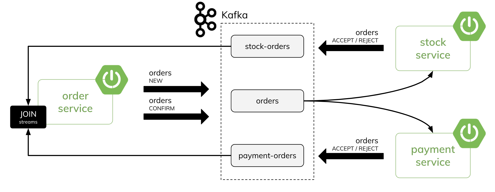
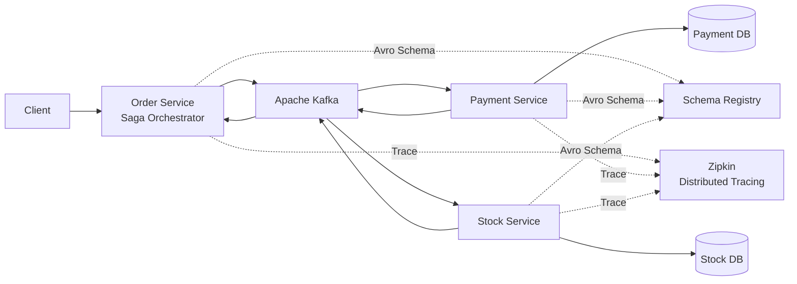

# Distributed Transactions in Microservices with Kafka Streams and Spring Boot

A reference implementation of **distributed transactions across microservices using Apache Kafka, Kafka Streams and the
Saga pattern**.

The project demonstrates how an order workflow can span multiple independently deployed services while maintaining
business consistency through **event-driven communication, local transactions and compensating actions** instead of
relying on a traditional distributed database transaction.

---

## 🎯 Problem Statement

In a monolithic application, an order transaction can often be handled using a single database transaction:

```text
BEGIN TRANSACTION

Create Order
    ↓
Reserve Stock
    ↓
Process Payment
    ↓
COMMIT
```

The problem becomes significantly more complex when these responsibilities are split across independently deployed
microservices.

For example:

```text
Order Service
     │
     ├──────► Payment Service
     │
     └──────► Stock Service
```

Each service owns its own business logic and local transaction boundary.

A failure in one service can therefore leave the overall business operation in an inconsistent state.

### Example

Consider an order requiring:

1. Order creation
2. Payment authorization
3. Inventory reservation

If payment succeeds but inventory reservation fails:

```text
Order        → SUCCESS
Payment      → SUCCESS
Inventory    → FAILED
```

A traditional ACID transaction cannot span these independent services reliably without introducing distributed
transaction coordination such as two-phase commit.

This project demonstrates an alternative approach using the **Saga pattern**:

```text
Local Transaction
       ↓
Kafka Event
       ↓
Next Local Transaction
       ↓
Kafka Event
       ↓
...
       ↓
Success → Commit business outcome
Failure → Execute compensating transaction
```

The objective is to achieve **eventual consistency** while keeping each service independently deployable and
independently responsible for its own local transaction.

---

# 🏗️ High-Level Architecture

The system consists of three core microservices:

- **Order Service** — initiates and orchestrates the business transaction
- **Payment Service** — processes the payment transaction
- **Stock Service** — reserves inventory

Apache Kafka provides the asynchronous communication backbone.

Kafka Streams is used by the Order Service to correlate responses from Payment and Stock services and determine the
final transaction state.

### HLD



### Logical Architecture



---

# 🔄 Distributed Transaction Flow

The transaction is implemented as a Saga-style workflow.

## 1. Create Order

The client requests a new order:

```text
Client
   │
   │ POST /orders/generate
   ▼
Order Service
   │
   │ Order(status = NEW)
   ▼
Kafka
```

---

## 2. Process Payment and Stock

The `Order` event is consumed by both downstream services:

```text
                 ┌───────────────┐
                 │     Kafka     │
                 └───────┬───────┘
                         │
              ┌──────────┴──────────┐
              ▼                     ▼
      Payment Service        Stock Service
              │                     │
              ▼                     ▼
       Local Transaction      Local Transaction
```

Payment and Stock independently execute their local transactions.

---

## 3. Publish Transaction Results

Each service publishes its result:

```text
Payment Service
      │
      └──► ACCEPT / REJECT

Stock Service
      │
      └──► ACCEPT / REJECT
```

---

## 4. Correlate Results

The Order Service consumes the responses and correlates them using the **Order ID**.

Kafka Streams is used to process the event streams and determine the overall transaction state.

```text
Payment Result ─────┐
                    │
                    ├──► Kafka Streams
                    │        │
Stock Result ───────┘        ▼
                       Correlation
                            │
                            ▼
                    Final Order Status
```

---

## 5. Final Decision

Depending on the responses, the Saga reaches one of several states:

```text
                 ┌──────────────┐
                 │ Order = NEW  │
                 └──────┬───────┘
                        │
              ┌─────────┴─────────┐
              ▼                   ▼
         Payment OK           Payment Failed
              │
              ▼
          Stock OK
              │
        ┌─────┴─────┐
        ▼           ▼
   CONFIRMATION   ROLLBACK
```

Possible final states include:

| State          | Meaning                                        |
|----------------|------------------------------------------------|
| `NEW`          | Order initiated                                |
| `ACCEPT`       | Local transaction accepted                     |
| `REJECT`       | Local transaction rejected                     |
| `CONFIRMATION` | Distributed transaction successfully completed |
| `ROLLBACK`     | Compensation required                          |
| `REJECTED`     | Overall transaction failed                     |

---

# 🔁 Saga Pattern

This implementation follows the **Saga orchestration** approach.

The Order Service acts as the coordinator of the business workflow.

```text
              Order Service
            Saga Orchestrator
                   │
          ┌────────┴────────┐
          │                 │
          ▼                 ▼
     Payment Service    Stock Service
          │                 │
          ▼                 ▼
      Local TX           Local TX
          │                 │
          └────────┬────────┘
                   │
                   ▼
              Final State
```

### Successful transaction

```text
Order
  │
  ├──► Payment ACCEPT
  │
  ├──► Stock ACCEPT
  │
  └──► CONFIRMATION
```

### Failed transaction

```text
Order
  │
  ├──► Payment ACCEPT
  │
  ├──► Stock REJECT
  │
  └──► ROLLBACK
          │
          └──► Payment compensation
```

The important architectural principle is:

> Each microservice commits its own local transaction. The overall business transaction is coordinated through events
> and compensating actions.

---

# 📨 Event-Driven Architecture

Kafka acts as the messaging backbone between services.

```text
Order Service
      │
      │ Order Event
      ▼
    Kafka
      │
      ├──────────────► Payment Service
      │
      └──────────────► Stock Service

Payment Service
      │
      │ Payment Result
      ▼
    Kafka
      │
      ▼
Order Service

Stock Service
      │
      │ Stock Result
      ▼
    Kafka
      │
      ▼
Order Service
```

This provides:

- Loose coupling
- Asynchronous communication
- Independent service deployment
- Event-driven processing
- Failure isolation
- Horizontal scalability
- Event replay capabilities

---

# 🧩 Technology Stack

| Technology                        | Version       | Purpose                           |
|-----------------------------------|---------------|-----------------------------------|
| Java                              | 25            | Application development           |
| Spring Boot                       | 4.1.1         | Microservices framework           |
| Spring Kafka                      | 4.x           | Kafka integration                 |
| Kafka Streams                     | 4.x           | Stream processing and correlation |
| Apache Kafka / Confluent Platform | 8.3.1 (KRaft) | Event streaming backbone          |
| Apache Avro                       | 1.12.2        | Event serialization               |
| Confluent Schema Registry         | 8.3.1         | Event schema management           |
| Gradle                            | 8.14+ or 9.x  | Build automation                  |
| Docker                            | —             | Local infrastructure              |
| Kubernetes                        | —             | Container orchestration           |
| Zipkin                            | 3.6.1         | Distributed tracing               |

The repository contains separate modules for `order-service`, `payment-service`, `stock-service`, a shared `common-lib`,
and Kubernetes manifests.

---

# 📦 Project Structure

```text
distributed-transactions-kafka/
│
├── common-lib/
│   └── Avro schemas and shared components
│
├── order-service/
│   ├── Saga orchestration
│   ├── Kafka Streams processing
│   └── REST API
│
├── payment-service/
│   ├── Payment processing
│   └── Kafka consumers/producers
│
├── stock-service/
│   ├── Inventory processing
│   └── Kafka consumers/producers
│
├── k8s/
│   ├── app/
│   ├── kafka/
│   └── zipkin/
│
├── arch.png
├── build.gradle
├── settings.gradle
└── kraft-kafka-schema-registry-ui.yml
```

---

# 🛠️ Prerequisites

Install the following:

- JDK 25+
- Gradle 9.x
- Docker Desktop
- Docker Compose
- Kubernetes
- `kubectl`
- Helm

Verify:

```bash
java -version
gradle -version
docker --version
kubectl version --client
helm version
```

---

# 🚀 Run Locally with Docker

The repository provides a Docker Compose environment containing Kafka, Schema Registry and Kafka UI/Control Center.

## 1. Configure Docker Host

### Linux / macOS

```bash
export DOCKER_HOST_IP=127.0.0.1
```

### Windows PowerShell

```powershell
$env:DOCKER_HOST_IP = "127.0.0.1"
```

---

## 2. Start Kafka Infrastructure

```bash
docker compose -f kraft-kafka-schema-registry-ui.yml up -d
```

Verify:

```bash
docker ps
```

The repository also provides a Kafka Control Center UI for inspecting Kafka topics and messages.

---

# 🏗️ Build the Shared Library

The shared library contains the common Avro-generated classes and schemas.

```bash
cd common-lib

gradle clean build
```

---

# ▶️ Start the Microservices

Open three terminal windows.

### Terminal 1 — Order Service

```bash
cd order-service

gradle clean bootRun
```

The Order Service exposes the REST API used to create and query orders.

---

### Terminal 2 — Payment Service

```bash
cd payment-service

gradle clean bootRun
```

---

### Terminal 3 — Stock Service

```bash
cd stock-service

gradle clean bootRun
```

The current repository uses this three-service startup sequence.

---

# 🧪 Test the Distributed Transaction

## Create Orders

Generate an order:

```bash
curl --location --request POST \
  'http://localhost:8080/orders/generate'
```

---

## Check Order Status

```bash
curl --location --request GET \
  'http://localhost:8080/orders'
```

The Order Service uses the responses from Payment and Stock to determine the final Saga state.

---

# 🔎 Observe Kafka Events

Use Kafka Control Center to inspect:

- Topics
- Partitions
- Consumer groups
- Produced events
- Consumed events
- Message payloads
- Consumer lag

This makes it possible to observe the distributed transaction as it moves through the system.

---

# 📊 Distributed Tracing

The project also includes Zipkin configuration for distributed tracing.

```text
Order Service
      │
      ├──── Trace ────►
      │
Payment Service
      │
      ├──── Trace ────► Zipkin
      │
Stock Service
      │
      └──── Trace ────►
```

This allows a transaction to be followed across multiple services and Kafka-based communication paths.

---

# ☸️ Kubernetes Deployment

The repository also contains Kubernetes manifests and Kafka Helm configuration.

## Start Kafka

```bash
kubectl apply -f ./k8s/kafka/kafka-kraft-stack.yaml -n kafka
```

---

## Build Application Images

```bash
gradle clean dockerTag
```

---

## Deploy Zipkin

```bash
kubectl apply -f ./k8s/zipkin
```

---

## Deploy Microservices

```bash
kubectl apply -f ./k8s/app
```

Verify:

```bash
kubectl get pods
kubectl get svc
```

---

## Test Through Kubernetes

Generate an order:

```bash
curl --location --request POST \
  'http://localhost:30002/orders/generate'
```

Check order status:

```bash
curl --location --request GET \
  'http://localhost:30002/orders'
```

The current Kubernetes configuration exposes the Order Service through port `30002`.

---

# 🧹 Cleanup

### Local Docker Environment

```bash
docker compose -f kraft-kafka-schema-registry-ui.yml down
```

### Kubernetes

```bash
kubectl delete -f ./k8s/app
kubectl delete -f ./k8s/zipkin

kubectl delete -f ./k8s/kafka/kafka-kraft-stack.yaml -n kafka
```

---

# 🧠 Key Distributed Systems Concepts Demonstrated

This project demonstrates several important distributed-systems concepts:

### Distributed Transactions

How to coordinate business transactions across independently deployed services.

### Saga Pattern

How to replace a global ACID transaction with a sequence of local transactions and compensating actions.

### Saga Orchestration

How a central orchestrator can coordinate multiple services through events.

### Event-Driven Architecture

How services communicate asynchronously using Kafka events rather than synchronous service-to-service calls.

### Kafka Streams

How multiple event streams can be correlated and processed to determine business state.

### Eventual Consistency

How distributed services can reach a consistent business state without a global database transaction.

### Schema Evolution

How Avro and Schema Registry can provide strongly defined event contracts between services.

### Distributed Tracing

How a transaction can be traced across multiple microservices.

### Kubernetes

How the complete event-driven system can be deployed and operated as containerized workloads.

---

# ⚠️ Failure Scenarios

A key purpose of this project is to understand what happens when distributed transactions fail.

## Payment Failure

```text
Order
  │
  ├──► Payment REJECT
  │
  └──► Order REJECTED
```

No successful payment should remain committed.

---

## Stock Failure After Payment Success

```text
Order
  │
  ├──► Payment ACCEPT
  │
  ├──► Stock REJECT
  │
  └──► ROLLBACK
          │
          └──► Compensate Payment
```

This is the fundamental Saga compensation scenario.

---

# 🔐 Production Considerations

This repository is primarily a reference implementation, but a production deployment would typically require additional
capabilities.

### Reliability

- Idempotent event processing
- Retry policies
- Dead Letter Topics
- Poison-message handling
- Consumer recovery
- Failure recovery workflows

### Data Consistency

- Transactional Outbox pattern
- Idempotency keys
- Exactly-once processing where appropriate
- Persistent Saga state
- Compensation tracking

### Kafka

- Multiple brokers
- Replication factor
- Partition strategy
- Consumer-group scaling
- Retention policies
- Monitoring and alerting

### Security

- TLS
- SASL authentication
- Kafka ACLs
- Secret management
- Network policies

### Observability

- OpenTelemetry
- Prometheus
- Grafana
- Distributed tracing
- Structured logging
- Consumer lag monitoring

### Kubernetes

- Resource requests/limits
- Liveness/readiness probes
- Horizontal Pod Autoscaling
- PodDisruptionBudgets
- NetworkPolicies
- StatefulSets for stateful infrastructure
- Helm-based application deployment

---

# 🔮 Possible Extensions

The architecture can be extended with:

```text
                 ┌───────────────┐
                 │ Order Service │
                 └───────┬───────┘
                         │
                      Kafka
                         │
        ┌────────────────┼────────────────┐
        ▼                ▼                ▼
     Payment          Stock           Shipping
      Service         Service          Service
        │                │                │
        └────────────────┼────────────────┘
                         ▼
                  Notification
                     Service
```

Potential enhancements:

- Transactional Outbox
- Debezium CDC
- OpenTelemetry
- Kafka Connect
- Dead Letter Topics
- Retry Topics
- Idempotent consumers
- Persistent Saga state
- Kafka Streams state stores
- Resilience4j
- Prometheus/Grafana
- Kubernetes autoscaling
- Chaos testing

---

# 📚 References

- [Apache Kafka](https://kafka.apache.org/)
- [Spring Kafka](https://spring.io/projects/spring-kafka)
- [Kafka Streams](https://kafka.apache.org/documentation/streams/)
- [Apache Avro](https://avro.apache.org/)
- [Confluent Schema Registry](https://docs.confluent.io/platform/current/schema-registry/)
- [Spring Boot](https://spring.io/projects/spring-boot)

---

# ⭐ Why This Project?

This repository demonstrates how a traditional distributed transaction problem can be solved using **event-driven
architecture and the Saga pattern**.

The focus is on the architectural trade-offs involved in building distributed systems:

```text
Traditional Approach
─────────────────────
Global ACID Transaction
        │
        ▼
Distributed Transaction Coordinator
        │
        ▼
Strong Consistency
        │
        ▼
Higher Coupling / Complexity


Saga Approach
─────────────
Local Transactions
        │
        ▼
Kafka Events
        │
        ▼
Saga Orchestration
        │
        ▼
Compensating Transactions
        │
        ▼
Eventual Consistency
```

The project is intended as a hands-on reference for understanding **microservices, Kafka, Kafka Streams, distributed
transactions, Saga orchestration, event-driven architecture, schema management, distributed tracing and Kubernetes
deployment**.